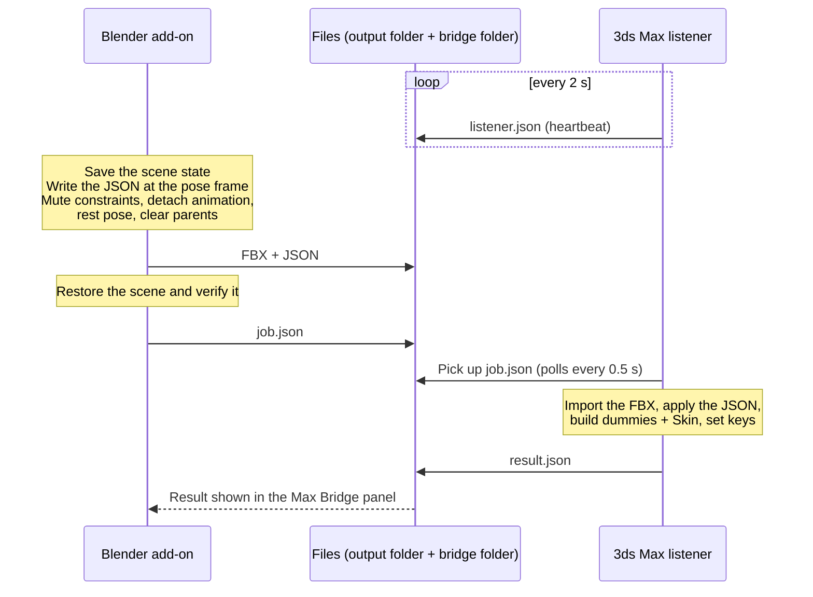

# Blender → 3ds Max Bridge

**One button in Blender, the result in 3ds Max.** Objects, hierarchy, Euler rotation orders, transforms, keyframe animation, collections and armatures arrive in 3ds Max as you built them in Blender. Armatures become **Dummy + Skin** setups with your painted weights.

[](LICENSE)


| Part | File | Runs in |
|---|---|---|
| Blender add-on | `blender_max_bridge.py` | Blender 3.6 LTS – 5.2 |
| 3ds Max script (listener + importer) | `BlenderMaxBridge_v2.1.ms` | 3ds Max 2022 – 2026 |

Created by Claude (Anthropic) under the leadership of Kruglov Iurii.

---

## Contents

- [How it works in one minute](#how-it-works-in-one-minute)
- [Features](#features)
- [Requirements](#requirements)
- [Installation](#installation)
- [Quick start](#quick-start)
- [Blender add-on reference](#blender-add-on-reference)
- [3ds Max script reference](#3ds-max-script-reference)
- [What happens on Send](#what-happens-on-send)
- [Armatures to Dummies and Skin](#armatures-to-dummies-and-skin)
- [Rotation, position and unit math](#rotation-position-and-unit-math)
- [JSON format (version 3)](#json-format-version-3)
- [Bridge folder protocol](#bridge-folder-protocol)
- [Performance](#performance)
- [Limitations](#limitations)
- [Troubleshooting](#troubleshooting)
- [Version history](#version-history)
- [Contributing](#contributing)
- [Credits](#credits)
- [License](#license)

---

## How it works in one minute

The geometry travels as an **FBX** file and everything else as a **JSON** file:

- **FBX:** static, unparented, axis-correct, skinned meshes in their rest pose.
- **JSON:** hierarchy, rotation orders, transforms, the exact keyframes, collections, bones and skin weights.

A small listener inside 3ds Max picks up each export, imports the FBX and rebuilds the rest from the JSON, key by key.



Your Blender scene is left exactly as it was. Everything the export changes is put back, and the add-on verifies it afterwards.

---

## Features

### Objects and animation
- **Hierarchy** is rebuilt with 3ds Max parenting.
- **Rotation orders** are kept. Each Blender rotation mode (XYZ, XZY, YZX, YXZ, ZXY, ZYX) becomes a 3ds Max *Euler XYZ* controller with the same axis order.
- **Quaternion and axis-angle objects** are converted to Euler XYZ, keeping the rotation continuous between keys.
- **Keyframes are transferred one to one.** Location goes to *Position XYZ*, rotation to *Euler XYZ* and scale to *Bezier Scale*.
  - Keys land on the same frame numbers, sub-frames included.
  - Only the axes you keyed in Blender get keys. No extra keys appear on X or Y if you only keyed Z.
- **Collections become layers**, nested like in Blender.
- **Units** are converted from Blender units to the 3ds Max system unit, whatever it is. The result is cross-checked against the imported FBX, so location keys and geometry always share the same scale.
- **Time line:** the 3ds Max time line is extended to Blender's frame range (it is never shortened).

### Armatures
- **Bones:** every deform bone becomes a 3ds Max **Dummy** named like the bone.
  - Orientation: **Z forward, Y up**.
  - Scale: 100 %.
  - The bone hierarchy is kept.
- **Skin:** every mesh deformed by an Armature modifier gets a **Skin** modifier.
  - It is bound to those dummies in Blender's rest pose.
  - It uses the painted weights, normalized exactly like Blender's Armature modifier normalizes them.
- **Bone animation becomes dummy keys.** Tangents follow Blender's keys (flat, linear, constant); see [Bind pose, pose and keys](#bind-pose-pose-and-keys).
  - Optional per-frame bake.
  - Armatures with bone constraints, bone drivers or NLA strips are always baked.
- **Objects parented to a bone** are parented to that bone's dummy.

### One-button bridge
- **Send to 3ds Max** does the whole job:
  1. Saves the scene state.
  2. Writes the JSON.
  3. Prepares and exports the FBX with fixed settings.
  4. Restores the scene exactly.
  5. Notifies 3ds Max.
- **Result in Blender:** the 3ds Max result, including warnings, is shown in Blender's panel.
- **Re-sending replaces the previous import.** This is optional, and safe: old objects are deleted only after the new FBX imported successfully.
- **Manual mode:** export the files only, then import them in 3ds Max with *Import JSON…*.
- **Autostart (optional):** the listener can start automatically with 3ds Max.

### Fast import in 3ds Max
- The JSON is read in one call and parsed by an iterative parser.
- Lookups use dictionaries, and the name-to-node table is built once.
- No exception-based `return`, `continue` or `exit` inside loops.
- Undo, Auto Key and viewport redraw are off while applying.
- Per-phase timings are printed to the MAXScript Listener.

---

## Requirements

| Component | Requirement |
|---|---|
| Blender | 3.6 LTS – 5.2, with the bundled FBX exporter (`io_scene_fbx`; the add-on enables it if needed) |
| 3ds Max | 2022 – 2026, with the bundled FBX importer |
| System | Windows (3ds Max). Blender and 3ds Max must see the bridge folder and the exported files **under the same paths**, which normally means the same computer |

---

## Installation

### Blender add-on
1. Download `blender_max_bridge.py`. Keep this exact file name, because it is the Python module name. A name with dots in it cannot be imported.
2. Install it from disk:
   - **Blender 4.2 – 5.2:** *Edit → Preferences → Add-ons*, then the **⌄** menu at the top right, then *Install from Disk…*, and pick the file.
   - **Blender 3.6 – 4.1:** *Edit → Preferences → Add-ons → Install…*, and pick the file.
3. Enable **Blender -> 3ds Max Bridge** (category *Import-Export*).
4. If you used the older *Blender JSON Exporter* add-on, disable it.
5. Optional: set a different **Bridge folder** in the add-on preferences. The default is `%LOCALAPPDATA%\BlenderMaxBridge`.

### 3ds Max script
1. Save `BlenderMaxBridge_v2.1.ms` in a permanent folder. Autostart refers to this path.
2. Run it with *Scripting → Run Script…*, or drag it into a viewport. The **Blender -> 3ds Max Bridge** dialog opens.
3. Press **Start listening**.
4. Optional: tick **Start the listener automatically when 3ds Max starts**.

Both sides use the same default bridge folder. If you change it on one side, change it on the other side too.

### Updating
- **Blender:** install the new `.py` over the old one.
- **3ds Max:** run the new `.ms` once. If autostart is on, it is re-pointed to the new script file automatically.

---

## Quick start

1. In **3ds Max**, run the script and press **Start listening**. The dialog shows *Listener: waiting for Blender*.
2. In **Blender**, open the 3D Viewport sidebar (**N**) and go to the **Max Bridge** tab. The panel shows **3ds Max listener: online**.
3. Press **Send to 3ds Max**.
4. The panel reports the progress:
   1. *Exported … objects …*
   2. *Waiting for 3ds Max…*
   3. *3ds Max picked up the job, importing…*
   4. *3ds Max: N objects (A animated) in T s, D dummies, S skinned*
5. In 3ds Max, the imported objects and dummies are selected. The MAXScript Listener shows the time spent in each phase.

Press **Send** again after changes in Blender. With *Replace same-named objects* on, the previous import is replaced instead of duplicated.

---

## Blender add-on reference

### Panel: *3D Viewport → Sidebar (N) → Max Bridge*

| Item | Description |
|---|---|
| **3ds Max listener: online / offline** | Online if the 3ds Max listener wrote its heartbeat less than 10 s ago |
| **Send to 3ds Max** | Exports the FBX and JSON, restores the scene and sends the job to 3ds Max |
| Status box | Progress and the 3ds Max result, with up to 6 warnings |
| **Objects** | *All visible* (all objects visible in the current view layer, the default) or *Selected* |
| **Pose frame** | Frame at which the static pose (FBX transforms and JSON values) is taken. Default 0, which is the frame 3ds Max reads the import at |
| **Output folder** | Where the `.fbx` and `.json` are written. Empty means next to the `.blend` file, or `<bridge folder>\exports` if the file is not saved |
| **File name** | Base name of the `.fbx` and `.json`. Empty means the `.blend` file name (`untitled` if not saved) |
| **Replace same-named objects in 3ds Max** | Default on. 3ds Max deletes objects, bone dummies and Skin helpers whose names match this export, but only after the new FBX imported successfully |
| **Bones -> Dummies + Skin** | Default on. Converts armatures as described in [Armatures to Dummies and Skin](#armatures-to-dummies-and-skin). Off: armatures go into the FBX as Blender bones |
| **Bake bone keys every frame** | Default off. Keys the dummies on every frame of the scene range, but only on axes that move |
| Resolved path | Shows where the files will be written |
| **Export FBX + JSON only** | The same export, without notifying 3ds Max |
| Folder button | Opens the output folder |

### File menu: *File → Export*
- **Send to 3ds Max (FBX + JSON)** does the same as the panel button.
- **Blender JSON (.json)** writes only the JSON (selected objects by default). It writes no FBX and sends no job.

### Add-on preferences
- **Bridge folder** is the folder shared with the 3ds Max listener. It holds the job, result and heartbeat files.

---

## 3ds Max script reference

| Control | Description |
|---|---|
| **Bridge folder** + **…** | Must match the Blender preference. It is stored in `<3ds Max plugcfg>\BlenderMaxBridge.ini` (section `[Bridge]`, key `Folder`) |
| **Start listening** / **Listening… (click to stop)** | Starts or stops the listener (a Windows Forms timer on the UI thread, polling every 0.5 s) |
| **Start the listener automatically when 3ds Max starts** | Writes `BlenderMaxBridge_AutoStart.ms` into the user startup scripts folder. On startup it loads this script and starts listening without opening the dialog |
| **Last import** | Result of the last job, and the number of warnings |
| **Import JSON…** | Manual import of a bridge JSON without Blender |
| **Import the FBX named in the JSON** | Imports the FBX next to the JSON first. Off: the JSON is applied to objects already in the scene |
| **Replace same-named objects (with FBX only)** | Same as Blender's *Replace* option, for manual imports |

All messages go to the MAXScript Listener with the prefix `[Blender->Max Bridge]`. A successful import ends with a timing summary like this one:

```
[Blender->Max Bridge] Done: <objects> objects (<animated> animated) in <t> s, <dummies> dummies, <skinned> skinned
[Blender->Max Bridge]   read+parse JSON <t> s, FBX <t> s, apply <t> s, bones/skin <t> s
```

Running the script again while it is listening replaces the old listener cleanly, and listening continues.

---

## What happens on Send

### In Blender

1. **Checks.** If an object is in NLA tweak mode, the export stops.
2. **Saves the scene state:**
   - frame and sub-frame, selection and active object;
   - parents (type, bone, vertices, parent inverse matrix);
   - raw transform values in every rotation mode;
   - actions and action slots, fake-user flags, NLA and driver states;
   - constraint mute states, including bone constraints;
   - the armatures' *Pose Position*.
3. **Writes the scene data at the pose frame:** objects, collections and armature data. Bone animation is evaluated by Blender itself, at every frame that has a bone key.
4. **Prepares the FBX export:**
   - mutes all constraints;
   - detaches actions (protected with a fake user, so none is lost) and disables NLA and drivers;
   - switches converted armatures to *Rest Position*, so deformed meshes are exported in their bind pose;
   - clears parents with **Keep Transform**;
   - selects the exported objects.
5. **Reads skin weights** from the evaluated meshes, the same meshes the FBX exporter writes, so vertex indices match.
6. **Writes** the JSON, then exports the FBX with the settings below.
7. **Restores** everything from step 2, then compares every object's world matrix with the original. A difference above 0.0001 is reported as a warning.
8. **Writes `job.json`** atomically and waits for the 3ds Max result.

### FBX export settings (fixed)

| Setting | Value |
|---|---|
| Limit to | Selected Objects |
| Object types | Empty, Camera, Lamp, Mesh, Other, plus Armature only when *Bones -> Dummies + Skin* is off |
| Custom Properties | Off |
| Scale | 1.00 |
| Apply Scalings | All Local |
| Forward / Up | **Y Forward / Z Up** |
| Apply Unit | On |
| Use Space Transform | On |
| Apply Transform | **On** (bakes the axis and unit conversion into the objects, so no object gets an extra rotation or scale) |
| Bake Animation | Off (animation travels in the JSON) |
| Path Mode / Batch Mode | Auto / Off |

### In 3ds Max (one job)

1. **Reads and deletes `job.json`.** Jobs older than 15 minutes, and repeated job ids, are ignored.
2. **Parses the JSON.**
3. **Imports the FBX:**
   - Mode *Add*, Animation off, Up axis Z.
   - Your own FBX importer settings are pushed before the import and restored after it.
   - With *Replace*, same-named nodes are first renamed out of the way (`…__BlenderBridgeOld`). They are deleted after a successful import, or get their names back if the import fails.
4. **Sets the time slider to 0 and resolves the unit factor** (see [units](#units)).
5. **Creates the bone dummies** in the bind pose.
6. **Applies the objects:**
   - rotation order, rotation, scale and parenting;
   - rotation and scale keys, then location keys;
   - layers.

   Undo, Auto Key and viewport redraw are off during this step.
7. **Adds the Skin modifiers** and writes the weights.
8. **Animates the dummies:** pose values first, then keys. Then puts the dummies on their layers.
9. **Selects the result and writes `result.json`** for Blender.

---

## Armatures to Dummies and Skin

### Dummy axes

Each dummy uses its bone's axes turned **+90° around the bone's X axis**:

| 3ds Max dummy axis | Blender bone axis |
|---|---|
| X | X |
| **Y (up)** | Z (the bone's "up", set by its roll) |
| **Z (forward)** | −Y (pointing from the tail towards the head) |

For a bone pointing backwards (+Y), the dummy's Z points forward and its Y points up. A constant rotation per bone does not change the deformation, because the Skin modifier only uses each dummy's motion relative to its bind pose.

### Which bones become dummies

These bones become dummies:
- all **deform bones**;
- their parent bones;
- bones that have objects parented to them.

Other bones, such as IK targets or controls, are not converted. If nothing in an armature needs converting, it is skipped with a warning.

Each dummy gets a display box of 10 % of its bone length (at least 0.5 system units). Its scale is always 100 %.

### Hierarchy

- **Bone chain.** Child bone dummies are linked to their parent bone dummies, as in Blender.
- **Root bone dummies** are linked to the object the armature is parented to, if that object is exported. Otherwise they are linked to the world.
- **The armature object itself** does not become a node, unless it is animated (object keys, object constraints or transform drivers). Only then does it become a Dummy named after the armature, and the root bones are linked to it.
- **Objects parented to the armature** are linked to the armature's parent, or to the armature dummy if one exists.
- **Objects parented to a bone** are linked to that bone's dummy.

### Bind pose, pose and keys

Every value is computed by Blender from `pose_bone.matrix`, which already includes parents, inheritance, constraints, drivers and NLA. Each value is written as the dummy's **local** position, Euler XYZ rotation and scale relative to its 3ds Max parent.

1. **Bind pose.** The mesh is exported in the armature's *Rest Position*. The dummies are created in the rest pose, and the Skin modifier is bound in that pose.
2. **Pose.** The dummies then get their values at the pose frame. This keeps bones you posed without keys.
3. **Keys.** Dummies are keyed at the frames where the bone has keys, per channel group: location, rotation and scale. Rotation uses the channels of the bone's rotation mode (quaternion, Euler or axis-angle).
   - Axes that do not move get no keys.
   - Scale uses *Bezier Scale*, which stores X, Y and Z in one key.

Tangents follow Blender's keys:

| Blender key | 3ds Max tangent |
|---|---|
| Constant interpolation | Step |
| Linear interpolation | Linear |
| Bezier with a flat handle | Flat |
| Anything else | Auto |

**Baking.** The dummies are keyed on every frame of the scene range, on the axes that move, in two cases:
- when **Bake bone keys every frame** is on;
- automatically, when the armature has bone constraints, drivers on bones, NLA strips, or bones with *Inherit Rotation* off or *Inherit Scale* other than *Full*.

### Weights

- **Source.** Weights are read from the vertex groups that match **deform** bones of the armature driving the mesh. Other vertex groups are ignored.
- **Normalization.** Each vertex's weights are divided by their sum, exactly like Blender's Armature modifier does. A vertex painted 0.5 on a single bone moves fully with that bone in Blender, so it gets weight 1.0 in 3ds Max.
- **Unweighted vertices.** If a vertex's total weight is 0.0001 or less, Blender does not deform it. Such vertices are bound to a helper dummy, `<mesh>__SkinStatic`, linked to the mesh, so they follow the mesh like in Blender. The helper is created only when needed.
- **Skin settings.** The Skin modifier keeps its default settings (linear blending). Weights are written with `skinOps.ReplaceVertexWeights`, which needs the Modify panel, so the command panel switches to *Modify* for a moment during the import.

### Not converted (you get a warning)

- **B-Bone** curvature (Segments > 1). The bone deforms as a straight bone.
- **Envelope** weights. Only vertex-group weights are used.
- **Preserve Volume** (dual quaternion). 3ds Max uses linear skinning.
- The Armature modifier's **vertex group mask**.
- **More than one Armature modifier** on a mesh. Only the first one is converted.
- **A bone and an object with the same name.** 3ds Max node names would clash.

---

## Rotation, position and unit math

### Objects
These formulas are unchanged since version 1.1.1.

```
W  = R1(a1) · R2(a2) · R3(a3)      rotation from the JSON Euler angles, in the object's rotation-mode order
L  = W · inverse(W_parent)          local rotation relative to the parent
decomposeEuler(L, mode)  →  Euler XYZ controller values (degrees)
location keys:  local = (location × U) · inverse(parent.transform)
```

| Blender rotation mode | 3ds Max Euler XYZ `axisOrder` |
|---|---|
| XYZ | 1 (XYZ) |
| XZY | 2 (XZY) |
| YZX | 3 (YZX) |
| YXZ | 4 (YXZ) |
| ZXY | 5 (ZXY) |
| ZYX | 6 (ZYX) |

The object values in the JSON are Blender's raw transform values. 3ds Max treats a child's raw values as its world values at the pose frame. That holds for children parented with *Ctrl+P → Object* or *Object (Keep Transform)*, as long as the parent has not moved since. Versions 1.x make the same assumption.

### Bone dummies
The dummies' local values are computed directly in Blender, as described above, and written to *Position XYZ*, *Euler XYZ* (axis order XYZ) and *Bezier Scale*.

### Units
- `unit_to_cm = 100 × Unit Scale`, or 100 if Blender's unit system is *None*. This is the same factor Blender's FBX exporter uses with *Apply Unit*.
- `U = unit_to_cm ÷ (centimetres per 3ds Max system unit)`. This works for any system unit and system unit scale.
- After the FBX import, the script measures the actual factor on the imported objects (imported position ÷ Blender location). The measured factor is used, with a warning, when all three conditions hold:
  - at least 3 objects can be measured;
  - 60 % of them agree within 0.5 %;
  - the result differs from `U` by more than 1 %.

  Location keys and dummies then always match the geometry, even with unusual FBX importer unit settings.

---

## JSON format (version 3)

The JSON is compact: one object per line, plain decimals only. Version 3 adds the `armatures` and `skins` sections to the version-1 layout, so older importers can still read the objects.

### Top level

```json
{
"format":"BlenderMaxBridge","version":3,"generator":"Blender 4.2.23 LTS / blender_max_bridge 2.1",
"source":"engine_rig.blend","fbx":"engine_rig.fbx","pose_frame":0,"fps":24,
"frame_start":0,"frame_end":81,"unit_to_cm":100,
"objects":{ ... },
"collections":{"layers":{"Helicopter":""},"objects":{"Engine_L":"Helicopter", ...}},
"armatures":{ ... },
"skins":{ ... }
}
```

| Key | Meaning |
|---|---|
| `fbx` | FBX file name next to the JSON (empty for a JSON-only export) |
| `pose_frame` | Frame of the static pose |
| `fps`, `frame_start`, `frame_end` | Scene timing. Keys keep their frame numbers, and an fps mismatch produces a warning |
| `unit_to_cm` | Blender units to centimetres |
| `collections.layers` | Collection name → parent collection name (`""` for top level) |
| `collections.objects` | Object name → collection name |

### Object record

Illustrative example:

```json
"Hatch_01":{"parent":"Hull","rotation_mode":"ZXY",
 "location":[0.42,-1.35,1.1],"rotation_euler":[1.5707963268,0,0],"scale":[1,1,1],
 "animation":{"location":{"X":[],"Y":[],"Z":[]},
              "rotation_euler":{"X":[],"Y":[],"Z":[{"frame":12,"value":0},{"frame":20,"value":-2.0943951024}]},
              "scale":{"X":[],"Y":[],"Z":[]}}}
```
Rotations are in radians, and keys are `{"frame", "value"}` per axis.

### Armature record

Example (two-bone engine rig, float noise rounded):

```json
"Engine_Rig_L":{"node":false,"parent":"Engine_L","bake":false,
 "world":{"location":[0.5687630773,6.923017025,2.2164149284],"rotation":[0,0,0],"scale":[1,1,1]},
 "bones":[
  {"name":"Engine_Bone_L02","parent":"Engine_Bone_L01","deform":true,"length":0.4193217754,
   "rest":{"location":[0,0,-0.9721029401],"rotation":[0,0,0],"scale":[1,1,1]},
   "pose":{"location":[0,0,-0.9721029401],"rotation":[0,0,0],"scale":[1,1,1]},
   "world_rotation":[1.5707963705,0,0],
   "animation":{"location":{},"rotation":{},
                "scale":{"X":[{"frame":42,"value":1,"to":"flat"},{"frame":43,"value":1,"ti":"flat","to":"flat"},
                              {"frame":50,"value":1.1817185879,"ti":"flat","to":"flat"},{"frame":51,"value":1.1817185879,"ti":"flat"}],
                         "Y":[ ... ],"Z":[ ... ]}}}
 ]}
```

| Key | Meaning |
|---|---|
| `node` | `true` if the armature object becomes a Dummy (it is animated) |
| `parent` | 3ds Max parent of the root bone dummies |
| `bake` | Keys are sampled on every frame |
| `world` | Armature world transform, used when `node` is true |
| `bones` | Ordered with parents first |
| `rest` / `pose` | Local position (Blender units), rotation (Euler XYZ, radians) and scale, in the bind pose and at the pose frame |
| `world_rotation` | Bind-pose world rotation of the dummy, used for objects parented to the bone |
| `animation` | Dummy-local keys per axis. `ti` / `to` are the in / out tangent types (`flat`, `linear`, `step`, `auto`) |

### Skin record

Example:

```json
"Engine_L":{"armature":"Engine_Rig_L",
 "bones":["Engine_Bone_L01","Engine_Bone_L02"],
 "vertices":136,"static_vertices":0,
 "weights":[[0,1],[0,1],[1,1], ...]}
```
`weights` holds one list per vertex, in FBX vertex order, as `[bone index, weight, bone index, weight, …]`. The weights are normalized, and an empty list marks a vertex that Blender does not deform.

---

## Bridge folder protocol

Default folder: `%LOCALAPPDATA%\BlenderMaxBridge`.

| File | Written by | Content |
|---|---|---|
| `listener.json` | 3ds Max, every 2 s while listening (deleted when stopped) | Heartbeat: `app`, `max_version`, `bridge`, `listening`. Blender only reads its modification time |
| `job.json` | Blender, atomically (temporary file + rename) | `format` (`BlenderMaxBridgeJob`), `version`, `id`, `created`, `fbx`, `json` (absolute paths), `replace`, `objects`, `blender`, `source` |
| `result.json` | 3ds Max, atomically, with retries | `id`, `status` (`ok` / `error`), `message`, `seconds`, `objects`, `warnings` |

| Timing | Value |
|---|---|
| Listener poll / Blender result poll | 0.5 s |
| Listener considered online | Heartbeat younger than 10 s |
| Job withdrawn if not picked up | after 30 s (listener offline) or 180 s (listener online but busy) |
| Blender stops waiting for a result | after 30 min |
| 3ds Max ignores a job file older than | 15 min |

While 3ds Max imports, its timer is paused, so the heartbeat pauses too. Blender knows the job was picked up and keeps waiting.

---

## Performance

The importer up to v1.1.1 was slow because of how it used MAXScript, not because of the math:
- `execute` for every number;
- `return` inside loops, which MAXScript implements with exceptions;
- key lookups that scanned dictionary keys on every frame;
- building the file string line by line;
- undo and redraw for every key.

Version 2.x removes all of these and keeps the math identical. The JSON is also smaller: 2.7× on the test scene (112 KB → 42 KB). Each import prints its phase timings to the MAXScript Listener. FBX import time depends on the geometry and is outside the script's control.

---

## Limitations

- **Frame numbers are kept as they are.** A different frame rate in 3ds Max only produces a warning; time is not remapped.
- **Interpolation between keys.** Flat and constant curves match Blender exactly, and so do linear location and scale curves. Other curve shapes, and linear rotations, follow 3ds Max interpolation between keys (*Auto* tangents; quaternion bone rotations are interpolated as Euler). Values at the keys always match. Use **Bake bone keys every frame** when the deformation must match on every frame.
- **Object animation** is read from the active action only. NLA strips, drivers and constraints on objects are not converted; constraints are muted for the FBX and their effect is not baked.
- **Object transforms** assume children were parented with *Keep Transform* (see [math](#objects)).
- **Skinning limits:** see [Not converted](#not-converted-you-get-a-warning). In addition:
  - Modifiers placed after the Armature modifier that change the vertex count are not supported.
  - A non-uniform scale on an armature object combined with rotated bones (shear) cannot be represented by 3ds Max PRS controllers.
- **Replace** deletes 3ds Max nodes whose names match the export: objects, bone dummies and `__SkinStatic` helpers. It does so only after a successful FBX import.
- **Bones and Skin need the FBX.** A JSON-only manual import (no FBX next to the JSON) skips them.

---

## Troubleshooting

| Symptom | What to do |
|---|---|
| Blender shows *3ds Max listener: offline* | In 3ds Max, run the script and press **Start listening**. Check that both sides use the same bridge folder |
| *3ds Max did not pick up the job* | 3ds Max was not listening, or was busy for more than 3 minutes. The files are kept, so use *Import JSON…* in 3ds Max |
| *FBX was imported at X units per Blender unit (expected Y)* | Your FBX importer unit settings differ from the 3ds Max system unit. The import is still consistent, but check *Units* in the FBX importer |
| *N object(s) not found in the scene* | Objects were renamed or not imported. Re-send with *Replace* on |
| *Skin has N vertices, Blender M* | A modifier changed the vertex count after the export. Apply it in Blender, or move it before the Armature modifier |
| Skin step errors | Make sure the command panel is open. The script switches it to *Modify* while skinning |
| *Scene restore problems* / *objects moved by up to …* in Blender | Rare (for example, a locked or linked object). Undo once in Blender, then report the message in an issue |
| Autostart still loads an old script | Run the new script once. The autostart file is re-pointed automatically |

---

## Version history

| Version | Changes |
|---|---|
| **2.1** | Armatures become Dummies (Z forward, Y up) with a Skin modifier, the painted weights (normalized like Blender) and the bone animation. Optional per-frame bake; automatic bake for constrained or driven bones. Objects parented to bones go to the bone dummies. Autostart re-points itself after an update |
| **2.0** | One-button bridge: FBX + JSON export with exact scene restore, and a 3ds Max listener with handshake files. Much faster 3ds Max import. Blender 3.6 – 5.2 (slotted actions in 4.4+), 3ds Max 2022 – 2026. System-unit handling with a measured check against the FBX. Working scale keys. Safe *Replace* |
| **1.1.1** | Keys only on the axes keyed in Blender |
| **1.1** | Blender collections become 3ds Max layers. Location keys use the *Position XYZ* controller |
| **1.0** | Blender JSON exporter add-on and 3ds Max importer: hierarchy, rotation orders, transforms and animation keys |

---

## Contributing

Bug reports and pull requests are welcome. For a bug, please include:
- the Blender and 3ds Max versions;
- the `[Blender->Max Bridge]` lines from the MAXScript Listener;
- if possible, the exported `.json`.

---

## Credits

Created by **Claude (Anthropic)** under the leadership of **Kruglov Iurii**.

Blender is a registered trademark of the Blender Foundation. 3ds Max and FBX are registered trademarks of Autodesk, Inc. This project is not affiliated with or endorsed by either.

---

## License

```
Blender → 3ds Max Bridge
Copyright (C) 2026 Kruglov Iurii

This program is free software: you can redistribute it and/or modify
it under the terms of the GNU General Public License as published by
the Free Software Foundation, either version 3 of the License, or
(at your option) any later version.

This program is distributed in the hope that it will be useful,
but WITHOUT ANY WARRANTY; without even the implied warranty of
MERCHANTABILITY or FITNESS FOR A PARTICULAR PURPOSE.  See the
GNU General Public License for more details.

You should have received a copy of the GNU General Public License
along with this program.  If not, see <https://www.gnu.org/licenses/>.
```

The full license text is in [LICENSE](LICENSE) (GNU General Public License v3.0).
